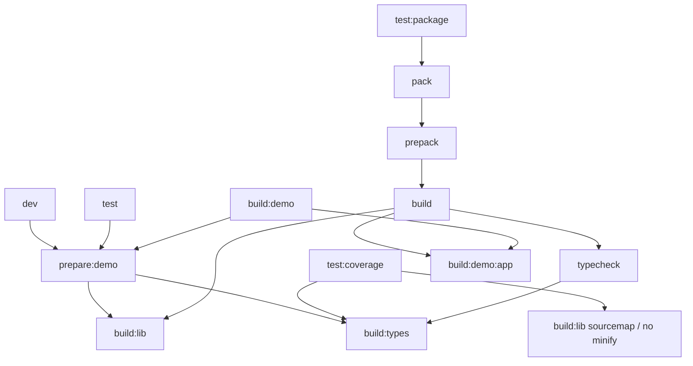

# 实施记录

## 基线与工作区

- 起点：main / e674424，waveform-analysis 0.2.1。Node 22.23.2、pnpm 10.32.1；计时及检查均使用该 Node，不使用 shell 默认 Node 24。
- 起点无已跟踪修改；2086 个已有未跟踪路径的 SHA256 见 [initial-worktree.json](evidence/initial-worktree.json)。本变更自身的 OpenSpec 文档属于授权修改范围；其他文件保持。旧分支截图 stash 不动。
- 先执行 pnpm install --frozen-lockfile，退出码 0。typecheck、lint:all、check:file-length、check:native-boundary（204 modules）、check:licenses（70 npm / 12 Rust）、typecheck:examples 本次均实际执行，退出码 0；类型及 lint 日志见 evidence/baseline-*.log。
- design 中 227 文件 / 2074 测试 / 336.40 秒属于之前扫描结果，不代表本次覆盖率通过。本次最终检查、包消费与浏览器结果以下文的集成验收记录为准。
- 浏览器更新基线见 [baseline.json](evidence/baseline.json)，包含平台、CPU、Chromium 版本、源摘要、原始值及中位数/p95。8 个规模/输入场景分别预热一次后测量五次；Vue 更新和装饰几何各五次。无 pageerror。CDP 堆采样不代表跨线程峰值或分配量，不能据此宣称 WASM/Worker 内存降低。基线脚本复用 animation-browser-server。

## 问题到源码与阶段

| 问题                | 当前源码                                                                        | 阶段 |
| ------------------- | ------------------------------------------------------------------------------- | ---- |
| 缺失质量门禁        | .github/workflows/{ci,release}.yml、.gitea/workflows/package.yml                | 2    |
| 重复声明/全 jsdom   | package.json、vite.config.ts、scripts/test-package.mjs                          | 3    |
| 颜色仍布局/中断交互 | src/chart/WaveformChart.ts、src/animation/NativeChartAnimation.ts               | 4    |
| 全量归一化/注册     | src/data/WaveformDataManager.ts、src/sampling/RenderSamplingController.ts       | 5    |
| 请求不结束/历史重放 | src/sampling/WorkerSamplingClient.ts、src/core/workerSampling/repository.ts     | 6    |
| 两次快照/几何编码   | src/adapters/vue/{WaveformChart.vue,VueChartAdapter.ts}、src/view/SeriesView.ts | 7    |
| 图例角色/指南过期   | src/view/LegendView.ts、AGENTS.md                                               | 8    |

不重建过期 CodeGraph；本记录以当前已知源码为准。project-optimization-2024 的资产 3.1–3.3、压缩/API 阶段保持原任务所有权，本变更不删除旧证据、不做 LFS 或历史迁移。

## 构建与测试准备

原调用关系：build → typecheck → build:types → vue-tsc -b；随后 build:lib 清空 dist，再 build:types，再 build:demo:app。因此一次 build 声明生成两次。test → prepare:demo → build:lib + build:types；coverage → 非压缩带 sourcemap 的 build:lib + build:types；test:package → pack → prepack → build。直接 pack 必须完整构建。

基线实际 build：声明生成 2 次、库 1 次、Demo 1 次，real 21.33 秒，退出码 0，见 [build-before.log](evidence/build-before.log)。修改为 build:lib → typecheck（含 build:types）→ build:demo:app，声明只生成 1 次，避免被库构建清空。独立 typecheck、test、coverage、dev、build:demo、pack 保留准备过程。

图中箭头为调用依赖，不表示可并行执行；build 中顺序固定为 lib → typecheck → demo:app。coverage 的库参数独立，dev 另启库和声明 watcher。实际计数和耗时见下方最终调用统计。

不采用跨命令缓存：prepack 为独立发布包提供完整准备，且 coverage 需保留独有 sourcemap/minify 配置。当前只去掉同一 build 内的重复生成，不按 dist 目录存在与否跳过构建；不存在缓存失效承诺。CI 的独立 build 与 test:package 仍各自验证完整产物，保留成本会在最终报告注明。

测试发现清单拆分前后均 227 文件，路径集合完全相同（evidence/test-discovery-*.json）；26 个纯算法/脚本测试放 Node，201 个 DOM 测试保留 jsdom + 原 setup。覆盖率阈值与统计配置保留，工程阶段完整结果见后文，最终结果见 evidence/final-checks.json。

构建修改后实际 build：声明生成 1 次、库 1 次、Demo 1 次，real 17.20 秒，退出码 0，见 [build-after.log](evidence/build-after.log)。单次前后计时仅作参考，不视为统计提速结论；确定性收益是声明调用从 2 次减到 1 次。Node 项目初次执行 26 文件 / 174 测试通过，2.92 秒；工程阶段完整覆盖率已执行，结果见后文。

## 证据与资产交接（对应 project-optimization-2024 3.1–3.3）

本变更长期保留的最小证据位于相邻 `evidence/`：环境和源摘要、性能原始样本、检查日志、测试发现清单、最终验收摘要。链接均相对于本 change。`initial-worktree.json` 仅作保全核对，不作为清理清单。

大型临时构建、独立消费者和浏览器生产 bundle 仍写入系统临时目录（`waveform-animation-browser-*`、`waveform-analysis-package-*`）；本地诊断写入 `/tmp/waveform-*`。临时目录无长期保留承诺，也不是外部托管的证据链接。足以复核的命令/退出码/计数/摘要和必要日志复制到 `evidence/`，因此结论不依赖临时目录继续存在。

未新增全局忽略规则，未移动、删除或重命名旧证据，也未改动 `project-optimization-2024/tasks.md` 的 3.1–3.3 复选框。后续该任务负责 WASM/Git 历史大小、LFS 托管及统一保留期限；本变更不重复实施。发布包仍由 package.json `files` 白名单限定，不包含 OpenSpec 性能报告或临时日志。

## 质量门禁验证

GitHub 普通 CI、GitHub release 和 Gitea package 均在 typecheck 已准备声明之后、包消费/pack/publish 之前执行 native-boundary、licenses、examples；run 块显式 set -eu。三个命令基线已实际通过。新增 tests/scripts/quality-workflows.test.ts 从实际工作流提取该验证块，仅在临时目录执行本地 pnpm 替身，分别令三项检查失败，证明非零退出且后续 PUBLISH_SENTINEL 不可达；3 个工作流测试通过，共 9 个失败模拟，见 evidence/quality-workflows.log。未执行完整发布工作流或读取发布凭据。

测试环境拆分后完整覆盖率实际通过（退出码 0）：228 文件 / 2077 测试（原 227/2074 加三个工作流测试），513.59 秒；语句 90.21%、分支 84.74%、函数 90.52%、行 93.01%，动画/core 更高阈值也通过。此结果在接入运行时优化前取得；见 evidence/engineering-coverage.log。新增 Worker/颜色等回归不包括在这次计数内，最终仍需集成复验。

复核基准发现 all-channels 在 single-channel 之后使用相同首通道引用，因此原 baseline.json 的 all-channels 实为其余七条子数据更新（旧实现依然全量重建）。保留原报告；将最终替换的每条 SingleWaveformData 描述对象重新创建，重跑 baseline-corrected.json，后续优化只对照修正版本。

## 运行时实现及兼容

- 颜色快速更新按实际变化字段判断，只刷新内部显示记录与 view；完整依赖表使用 `Record<keyof WaveformChartProps, ...>` 约束新增字段。原生/Vue 手势、滚轮、标注草稿/拖拽、动画、导出及 finished 回归见 nativeColorUpdates.test.ts。具体行为见 [compatibility.md](compatibility.md)。
- 数据准备按归一化 ID + SingleWaveformData 子引用复用，指标和错误域仍基于完整源。资源索引仅保留当前系列；传输数据集带单调版本键，部分替换只释放被替换/删除的数据集，完整替换保留整体重置路径。
- 旧注册和混合采样通过受控取消结束，最新调度无需等待旧 deadline；过期响应、诊断和错误不覆盖新 generation。请求有内部 30 秒有限 deadline，超时终止 Worker 并按已有采样策略回退。恢复直接准备最新版本，不循环重放历史 revision。
- Vue 组件拥有一次快照，内部适配入口消费快照；公开直接适配器调用仍复制。图例为 listitem 内原生 button，SVG 的 group 角色允许交互子节点进入可访问性树；非交互按钮保持 disabled，移除 aria-pressed。
- 传输和几何缓存均为测量候选，不接入生产，条件任务依据见 [performance.md](performance.md)。没有扩大公共 API 或引入配置开关。

## 最终集成验收约定

使用 `git archive HEAD` 创建系统临时副本，覆盖本次修改及明确新增的 src/tests/scripts 文件；清单见 [clean-snapshot.json](evidence/clean-snapshot.json)。不复制原有未跟踪证据，不创建新分支或修改原 stash。副本中安装冻结依赖，再执行全部门禁和实际 tarball 消费。所有实际命令、退出码及耗时以 [final-checks.json](evidence/final-checks.json) 和对应 final-*.log 为准，未退出的命令不算通过。

独立 test、build:demo、pack 前仅删除隔离副本的 dist/dist-demo，验证它们自行准备产物；原工作区不做清理。dev 从无生成产物状态启动并检查 HTTP、声明及库输出，然后停止 watcher。发布工作流只验证本地 fail-fast 模拟，不运行发布/部署。

浏览器使用真实 Chromium 生产 bundle。原生/Vue 在两种尺寸验证交互和故障恢复，另验 Demo 路由；可访问性树和键盘通过不代表真实屏幕阅读器通过，后者及其他浏览器明确未验证。截图、运行版本及具体断言见 [browser-verification.json](evidence/browser-verification.json)。

最终全覆盖率在隔离副本执行 `pnpm test:coverage --maxWorkers=2`，退出码 0：233 文件 / 2113 测试，Vitest 520.03 秒（含准备总计 526.63 秒）；语句 90.26%、分支 84.85%、函数 90.65%、行 93.04%，动画/core 更高阈值同时通过。完整 build 21.20 秒、test:package 33.31 秒均退出码 0；后者实际打包、安装并通过三入口 ESM/CJS/类型/CSS/WASM 与浏览器消费者验证。初次最终 coverage 曾为处理性能问题手动终止，该次不算通过；最终结论仅指 final-test-coverage.log 的完整运行。

基线记录的 2086 个未跟踪路径已按 SHA256 核对，除本 change 的授权文档外无变化，见 evidence/worktree-preservation.json。未提交、推送、发布或操作旧 stash。

## 最终准备调用统计

最终性能证据采用五次预热与五次样本，并补充挂载后直接完整替换、显式 GC 的独立对照及首次 SVG 几何变更时刻。完整替换与局部替换的收益、剩余端到端成本和无法直接观测的内存范围分别记录；结果和采用决策见 performance.md。原生/Vue 四组交互与六组 Demo 检查共 10 组均通过，Chromium 141.0.7390.37，无 pageerror；真实屏幕阅读器和其他浏览器未验证。

各行来自实际命令日志，不按脚本静态推算；见 [preparation-counts.json](evidence/preparation-counts.json)。

| 命令               | 秒     | 声明 | 库  | Demo | prepack | 退出码 |
| ------------------ | ------ | ---- | --- | ---- | ------- | ------ |
| pnpm typecheck     | 13.88  | 1    | 0   | 0    | 0       | 0      |
| pnpm test:coverage | 526.63 | 1    | 1   | 0    | 0       | 0      |
| pnpm build         | 21.20  | 1    | 1   | 1    | 0       | 0      |
| pnpm test:package  | 33.31  | 1    | 1   | 1    | 1       | 0      |
| pnpm test          | 320.95 | 1    | 1   | 0    | 0       | 0      |
| pnpm build:demo    | 10.26  | 1    | 1   | 1    | 0       | 0      |
| pnpm pack          | 17.45  | 1    | 1   | 1    | 1       | 0      |

单独 test 从无产物状态再次通过 233 文件 / 2113 测试，Vitest 311.66 秒；与 coverage 的耗时差包含 V8 收集/映射成本，不能单独归因于环境拆分。独立 build:demo、直接 pack 都重新生成一次库/声明/Demo，未使用跨命令缓存。

dev 检查从无 dist/dist-demo 状态启动，12.79 秒内 HTTP 200、库及三入口声明齐全、声明 watcher 报告零错误；随后按计划 SIGTERM 停止进程组（pnpm 包装进程状态 -15，属于检查后的主动停止），无 watcher 残留。检查程序退出码 0，见 [dev-check.json](evidence/dev-check.json) 与 final-dev.log。

直接 tarball 的 SHA256、三入口/CSS/声明和嵌入 Worker 的 WASM 清单见 [direct-pack-manifest.json](evidence/direct-pack-manifest.json)。WASM 由打包代码嵌入，并不要求 tarball 另有独立 .wasm 文件；真正执行后端由 test:package 浏览器验证，Demo 也核对十通道均为 wasm。根 dist-demo/index.html 已由独立 build:demo 与 pack 的构建日志确认。

最终增补的性能隔离脚本另经 ESLint 零警告检查（replacement-probe-lint.log）；此前完整 lint:all 及增补后的完整 lint:all-complete 均通过。
